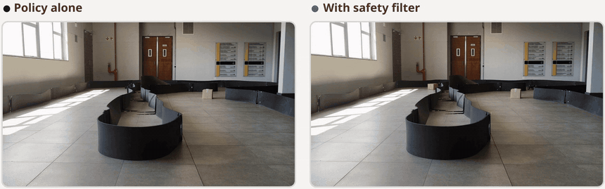

# Safe Reinforcement Learning Using a Predictive Safety Filter for Obstacle Avoidance in Autonomous Racing

Code, trained policies and sample data for the MEng thesis of Nico Märtin
(Electronic Systems Laboratory, Stellenbosch University, 2026).

**[Project page and video](https://ocinnitram.github.io/psf-roboracer/)**

<p align="center">
  <a href="https://ocinnitram.github.io/psf-roboracer/"></a>
</p>

A PPO racing policy for the 1:10 scale RoboRacer vehicle is trained in a high-fidelity simulator
and deployed on the vehicle without further training, using only onboard localisation. A predictive
safety filter sits between the policy and the actuators: every control period it checks that the
vehicle can still pass the obstacles tracked from onboard LiDAR, or stop, without a collision, and
corrects the policy's command when it cannot.

| | policy alone | with safety filter |
|---|---|---|
| Simulation, 500 unseen obstacle layouts | 94.0 % completed | 99.8 % completed |
| Real vehicle, four obstacle layouts | crashed on 2 of 4 | 113 obstacle passes, no collision |

The whole control computation runs onboard the Jetson Orin in under 20 ms.

## Repository

```
vehicle/      params.h: the single definition of the vehicle (mass, geometry, tyres, actuators,
              limits, sensor mount); the build generates params.yaml from it
sf/           the predictive safety filter (C++17, Python bindings via pybind11): vehicle model,
              obstacle detection and tracking, backup policy, certification QP; track data
sim/          the C simulator (libroboracer.so) and its Python interface
ppo/          PPO training, configurations, hyper-parameter sweeps
evaluation/   evaluation of a trained policy with or without the filter; frozen obstacle layouts;
              reactive and planning baselines
trackgen/     SLAM occupancy map -> centreline, raceline, obstacle zones and compiled track
outputs/      trained_agents/: the thesis policies, racing-agent (empty track) and
              obstacle-agent (obstacles), seeds 17, 76 and 693, best evaluation checkpoint
data/sample/  one real-vehicle run and the matching simulation runs (see its README)
docs/         project page
```

Each code directory has a README describing its contents and interface. `sf/README.md` gives an overview
of the safety filter; the thesis gives its full derivation.

## Installation

Requires Linux (x86-64), a C/C++ compiler with OpenMP, make, CMake, and [uv](https://docs.astral.sh/uv/).
uv installs the pinned Python (3.10) and the locked dependencies (`uv.lock`); training and
evaluation run on the CPU only.

```bash
git clone --recurse-submodules https://github.com/ocinnitram/psf-roboracer.git
cd psf-roboracer
./rebuild      # Python environment, simulator and safety-filter module
./test         # simulator, filter and Python tests
```

`./rebuild render` downloads [raylib](https://www.raylib.com/) 5.5 and links the simulator against it
for a live view (`./eval ... --render`); this additionally needs the OpenGL and X11 development
libraries.

## Reproducing the results

Evaluate the obstacle policy on the 500 unseen layouts, without and with the safety filter:

```bash
./eval obstacle-agent --sf off --seeds 17    # success 0.9400
./eval obstacle-agent --sf on  --seeds 17    # success 0.9980
```

The same policy on the four layouts measured on the real vehicle (the simulation half of
`data/sample/`); add `--render` to watch:

```bash
./eval obstacle-agent --sf off --seeds 17 --eval-set car-0908            # crashes on layout D (k3)
./eval obstacle-agent --sf on  --seeds 17 --eval-set car-0908 --log      # completes all four
```

Each run writes `summary.json`, `layouts.tsv` and, with `--log`, a per-tick CSV and plot to
`outputs/eval/`. Results are deterministic; only the measured computation times vary. `./eval --help`
lists all options, including the reactive baselines (`--driver ftg|disparity|spliner|spliner-pp`).

Retrain the thesis policies from their stored configurations (5M steps each):

```bash
./train racing --base racing-agent --seeds 17,76,693        # empty track
./train obstacle --base obstacle-agent --warmstart racing-agent --seeds 17,76,693
```

The obstacle policy of each seed is warm-started from the racing policy of the same seed. `./train`
and `./train obstacles` start new runs from the default configs in `ppo/configs` (see `ppo/README.md`).

Hyper-parameter sweeps (`./sweep`, `./select`) and `./train --wandb` log to
[Weights & Biases](https://wandb.ai/) and need an account; nothing else does.

A new track is built from a SLAM map with `./track <map> --direction cw` (see `trackgen/README.md`).

## Vehicle

The vehicle runs the same safety-filter module (`sf/`) and the same policy weights inside a ROS 2
node on a Jetson Orin. The vehicle software (drivers, localisation and the ROS 2 nodes) is not part
of this repository; `data/sample/vehicle/` contains a run recorded with it.

## Citation

```bibtex
@mastersthesis{maertin2026psf,
  author = {M{\"a}rtin, Nico},
  title  = {Safe Reinforcement Learning Using a Predictive Safety Filter for Obstacle Avoidance in Autonomous Racing},
  school = {Stellenbosch University},
  year   = {2026},
  month  = nov,
  url    = {https://github.com/ocinnitram/psf-roboracer}
}
```

## License

MIT, see [LICENSE](LICENSE), except `trackgen/stages/raceline.py` and `trackgen/stages/mintime.py`,
which are adapted from LGPL-3.0 code and remain under that license (`LICENSES/`). Third-party code is
listed in [THIRD_PARTY_NOTICES.md](THIRD_PARTY_NOTICES.md).

## Acknowledgements

Supervised by Prof Lijun Zhang and Dr JC Schoeman. Part of this work was done at the MECO lab, KU Leuven.
